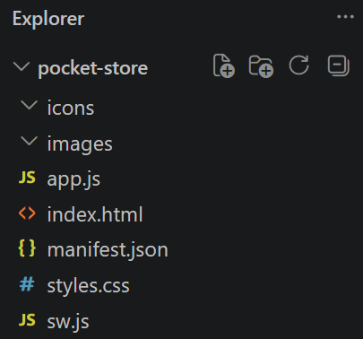
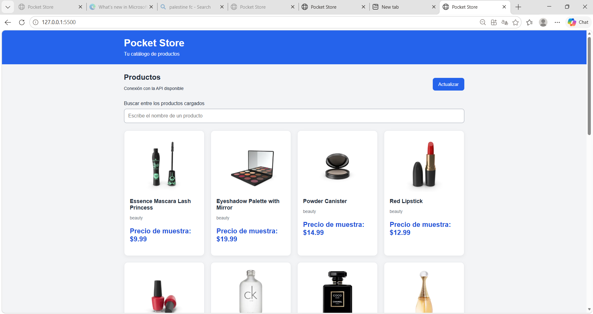
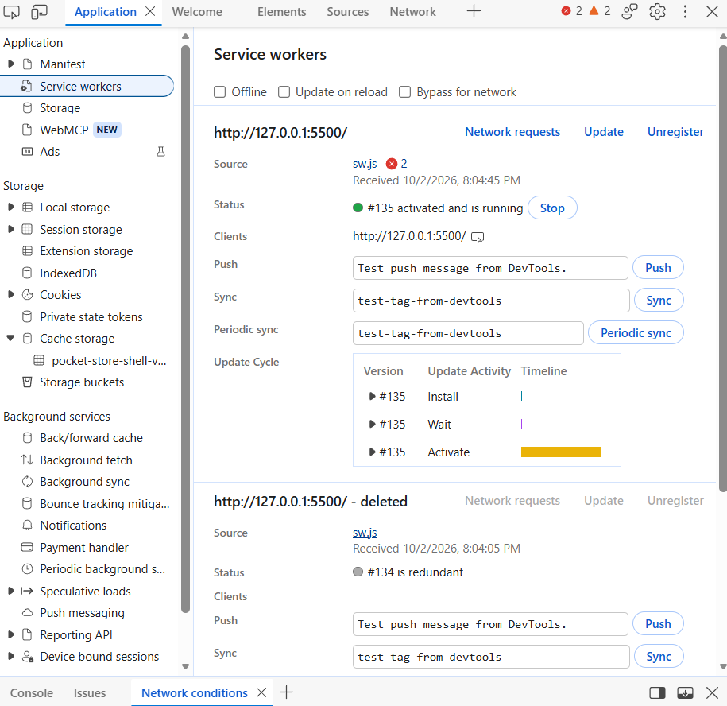
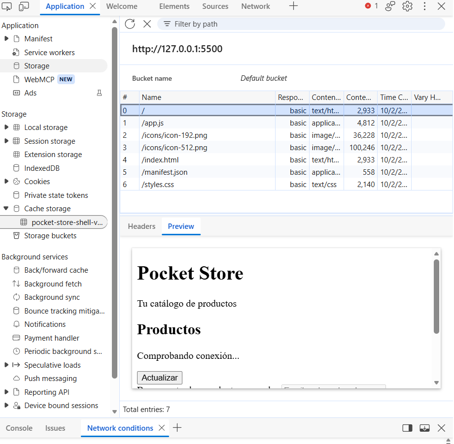
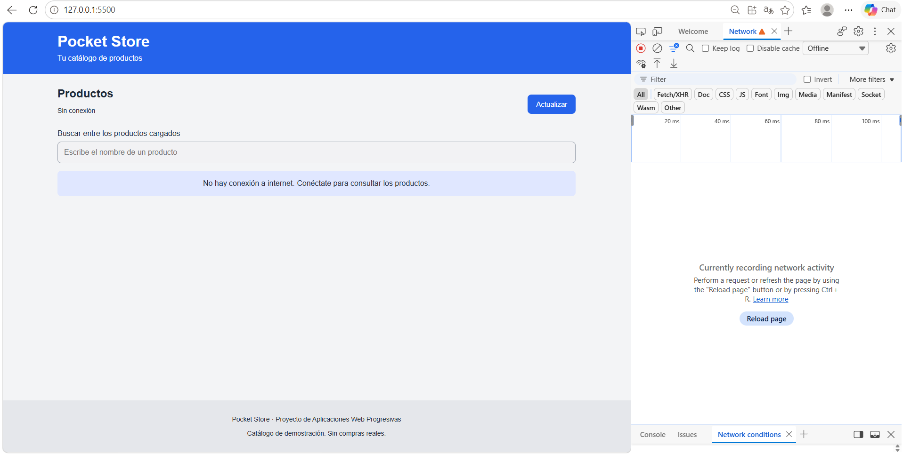

# Pocket Store

Aplicación web de una sola página desarrollada con HTML, CSS y JavaScript
para la materia Aplicaciones Web Progresivas.

## Autor

Iram Guillermo Álvarez Fuyivara

## Funcionalidades

- Consulta de 20 productos de la API pública DummyJSON.
- Visualización de nombre, imagen, categoría y precio de muestra.
- Búsqueda entre los productos cargados.
- Botón para actualizar el catálogo.
- Manifiesto para instalación.
- Service Worker con eventos install, activate y fetch.

## Comportamiento sin conexión

Después de una primera visita con conexión y de la instalación del
Service Worker, la estructura de la aplicación puede abrirse sin internet.

Sin conexión, no se muestran productos. Se muestra la leyenda:

“No hay conexión a internet. Conéctate para consultar los productos.”

La caché guarda únicamente los archivos del App Shell.
Los productos y sus imágenes externas no se almacenan para consulta offline.

Esta implementación no permite consultar el catálogo sin internet.

## Ejecución local

Desde la carpeta del proyecto:

    python -m http.server 5500

En Windows también puede utilizarse:

    py -m http.server 5500

Abrir http://localhost:5500/

O en su defecto, usar un servidor local como Live Server.

No ejecutar abriendo index.html directamente como archivo.

## Estructura

- index.html: estructura visual.
- styles.css: estilos.
- app.js: consulta de productos, búsqueda y registro del Service Worker.
- sw.js: ciclo de vida y caché del App Shell.
- manifest.json: configuración de instalación.
- icons/: iconos de la aplicación.
- images/: evidencias del desarrollo y las pruebas.

## Evidencias

### Estructura del proyecto

### Productos con conexión

### Service Worker

### Caché del App Shell

### Aplicación sin internet

## Fuentes

- https://dummyjson.com/docs/products
- https://developer.mozilla.org/en-US/docs/Web/API/Service_Worker_API/Using_Service_Workers
- https://developer.mozilla.org/en-US/docs/Web/API/Navigator/onLine

## Apoyo de IA

Se utilizó ChatGPT como apoyo para planear la estructura y elaborar
una propuesta de código. La ejecución, las pruebas y las capturas
deben realizarse en el entorno local del autor.